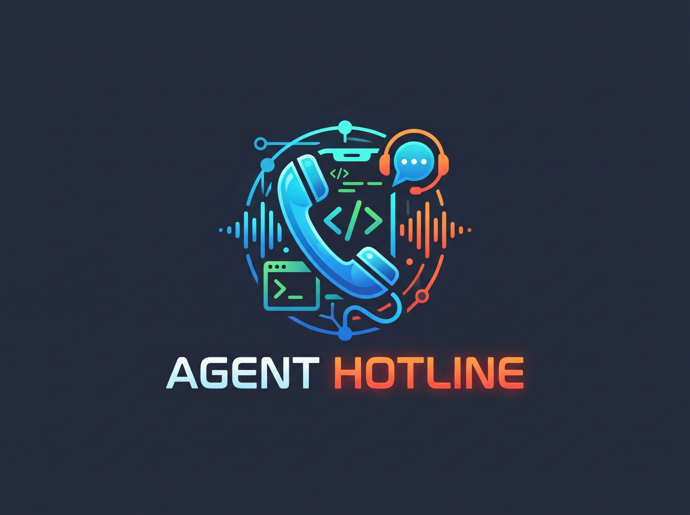

<p align="center">
  
</p>

# Agent Hotline

**Let your AI agent phone you and talk.** When an agent finishes a long task or needs a
decision, it rings your phone, speaks a short update, listens to your answer, and carries on.
Everything runs on your own machine with free pieces: a free Linphone SIP account,
[whisper.cpp](https://github.com/ggerganov/whisper.cpp) for speech-to-text and
[Piper](https://github.com/rhasspy/piper) for the voice. No paid telephony, and no API key for
the conversation: the agent's own model does the thinking.

It is a standard [MCP](https://modelcontextprotocol.io) server, so it is not tied to one model
or product. See [which agents work](#works-with-any-mcp-agent) below.

This is a fork of [mohitbadwal/ringback](https://github.com/mohitbadwal/ringback)
(Apache-2.0). It adds Docker images for **CPU and NVIDIA GPU**, a Windows setup path, faster
turn-taking, and instructions for using it with any agent. The server and Docker images keep
upstream's names (`ringback-voice`, `ringback`, `ringback-gpu`).

```text
You  <-- phone call --  Linphone app  <-- SIP/SRTP --  Docker container
                                                        |-- MCP server (stdio)
Your agent (any MCP client)  -- tools: call_start, converse, call_end -->  |-- whisper.cpp (CPU or GPU)
                                                        '-- Piper voice
```

## Works with any MCP agent

| Client | Status |
|---|---|
| Claude Code | **Tested**, live calls on CPU and GPU images |
| Plain Python (no framework) | **Tested**, see [examples/call_from_python.py](examples/call_from_python.py) |
| Claude Desktop, Cursor, VS Code, OpenAI Codex CLI | config formats documented, **not run here** |
| Gemini CLI, Windsurf, Continue, MCP SDKs, agent frameworks | same command, **not verified**; see the client guide |
| Agents without MCP support | not covered |

Per-client setup, timeouts and caveats: [docs/CLIENTS.md](docs/CLIENTS.md). Ready-made rules
that tell any agent when and how to call: [integrations/generic/AGENT_RULES.md](integrations/generic/AGENT_RULES.md).

## Choose an image

| | CPU | GPU (NVIDIA) |
|---|---|---|
| Dockerfile | `Dockerfile` | `Dockerfile.gpu` |
| Speech-to-text | `base.en`, about 1.3 s per turn | `small.en`, about 0.3 s per turn |
| Image size | about 3 GB | about 15 GB |
| Build | `docker build -t ringback .` | `docker build -f Dockerfile.gpu -t ringback-gpu .` |
| Run flag | none | `--gpus all` |

Same Python code, voice and SIP stack in both. Details and trade-offs:
[docs/SETUP_DOCKER_CPU_GPU.md](docs/SETUP_DOCKER_CPU_GPU.md).

## Quick start

1. Create a free account at <https://subscribe.linphone.org> and sign in to the Linphone app
   on your phone.
2. Build an image (table above).
3. Put your SIP details in `voice.docker.env` (gitignored; never commit it).
4. Connect your agent. For Claude Code:

```bash
# CPU
claude mcp add ringback-voice --scope user -- docker run -i --rm --env-file /path/to/voice.docker.env ringback
# GPU
claude mcp add ringback-voice --scope user -- docker run -i --rm --gpus all --env-file /path/to/voice.docker.env ringback-gpu
```

   Other agents run the same `docker run` command; see [docs/CLIENTS.md](docs/CLIENTS.md).
5. Start a **fresh** agent session and ask it to call you and say hello.

New to Docker, SIP or Android? Follow the step-by-step walkthrough in
[docs/SETUP_GUIDE.md](docs/SETUP_GUIDE.md).

## Documentation

| Doc | What it covers |
|---|---|
| [docs/SETUP_GUIDE.md](docs/SETUP_GUIDE.md) | from zero to your first call, step by step |
| [docs/CLIENTS.md](docs/CLIENTS.md) | using it with any agent or LLM |
| [docs/SETUP_DOCKER_CPU_GPU.md](docs/SETUP_DOCKER_CPU_GPU.md) | CPU vs GPU, build notes, switching, fixes for problems we hit |
| [docs/ARCHITECTURE.md](docs/ARCHITECTURE.md) | how a call works and where each second of a turn goes |
| [integrations/](integrations/) | agent rules for any agent, plus a Claude Code subagent |
| [examples/](examples/) | a plain-Python client |
| [UPSTREAM_README.md](UPSTREAM_README.md) | upstream's full README (macOS and Linux native setups) |

## What changed from upstream

- `mcp` pinned below 2, because the upstream image crashes at startup with the current release.
- Piper stays loaded between sentences: about 0.4 s per sentence instead of about 3 s.
- The listening loop no longer blocks on transcription and skips a redundant second pass.
- `Dockerfile.gpu`: whisper.cpp built with CUDA.
- Agent-neutral wording in the tool descriptions, and the protocol stream is kept free of stray
  log lines (images built before this change need a rebuild to get it).
- The upstream workflow that publishes a public image is manual-only here.

## Status and limits

Honest list of what is and is not proven:

- Verified: two-way calls through Docker Desktop on Windows 11, on both images, with Claude
  Code; the offline test suite passes on both.
- Not yet verified: any client other than Claude Code and plain Python; the Claude Code
  subagent end to end in a fresh session; a second call within one server session; live calls
  on the CPU image with all the changes.
- English speech models only. Other languages need a different whisper model and Piper voice.
- The machine must stay on, Docker Desktop must be running, and the Linphone app must stay
  connected for the phone to ring.
- The voice engine depends on GPL software (pjproject). Read [NOTICE](NOTICE) before
  redistributing a built image.

## License

Apache-2.0, see [LICENSE](LICENSE). Credit for the original project to
[mohitbadwal](https://github.com/mohitbadwal).
