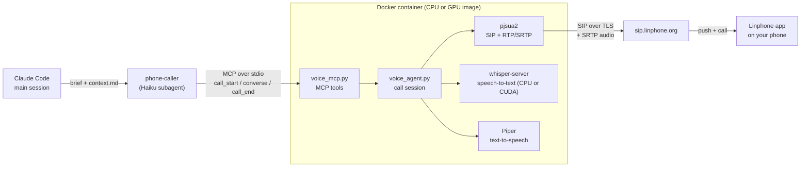
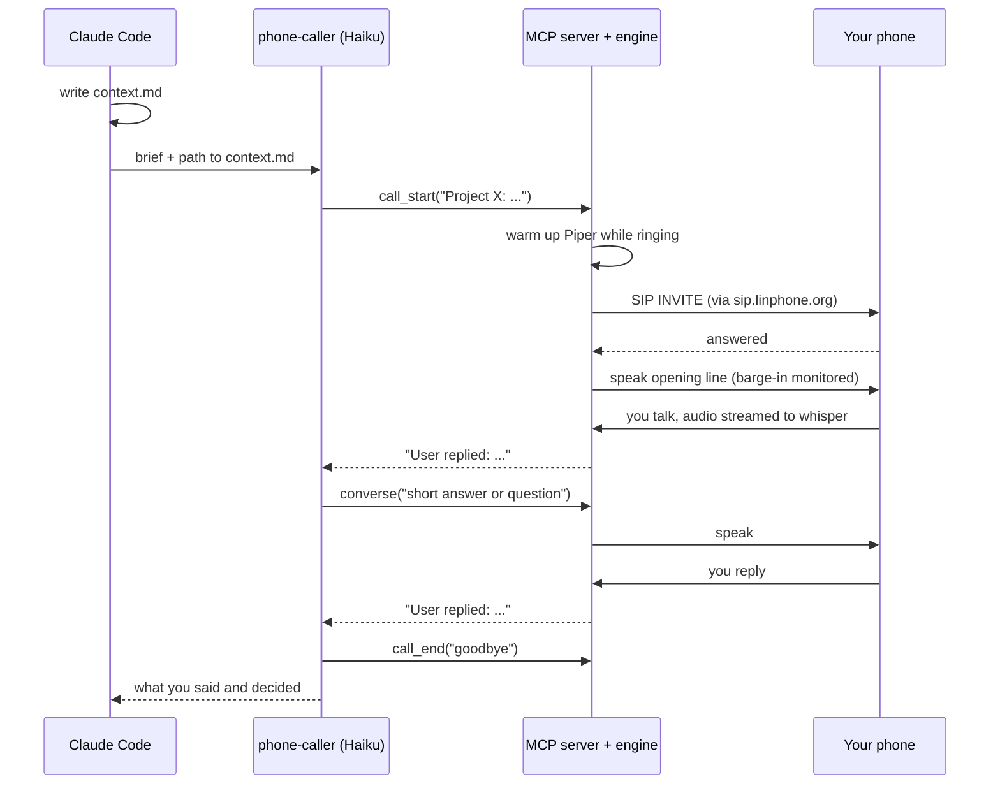

# Architecture

How a phone call between Claude Code and you works, and where the time goes in each turn.
Written from reading the code (`voice_mcp.py`, `voice_agent.py`, `platform_compat.py`) and from
timing runs on Windows 11 with Docker Desktop. Numbers marked *measured* came from those runs;
*estimate* means they did not.

## The pieces

| Piece | What it does | File |
|---|---|---|
| `phone-caller` agent | Reads a `context.md`, makes the call, asks the questions, returns what you said. Runs on Haiku. Instructed to only read, never edit, during a call (a rule in its prompt, not enforced by the tool). | `claude/phone-caller.md` |
| MCP server | Exposes the call tools over stdio: `call_start`, `converse`, `speak`, `listen`, `get_conversation`, `call_end`, `call_status`. | `voice_mcp.py` |
| Call session | Owns the SIP call, plays speech, records and transcribes you, detects end of turn and interruptions. | `voice_agent.py` |
| SIP stack | pjproject / pjsua2 built from source, with a Python binding. Headless: it uses a null audio device and works on WAV files. | built in the Dockerfile |
| Speech-to-text | whisper.cpp, run as a local `whisper-server` on 127.0.0.1:8642. `base.en` on CPU, `small.en` with CUDA on GPU. | `Dockerfile`, `Dockerfile.gpu` |
| Text-to-speech | Piper (`en_US-lessac-medium`), loaded once in-process, then converted to 16 kHz mono by ffmpeg. | `platform_compat.py` |
| Phone side | The Linphone app, registered to the same account, rings and carries the audio. | your phone |

## A call, step by step

Things worth knowing about how the engine behaves:

- **The agent account does not register.** `voice_agent.py` sets an empty registrar, so only
  your phone's Linphone app is registered. The server dials your own SIP address through the
  Linphone proxy and your phone rings. (Registering both would cause a self-call fork.)
- **Secure transport.** Signalling is TLS to `sip.linphone.org`; audio is SRTP and mandatory.
- **Media through NAT.** A container behind Docker Desktop's NAT advertises a private address
  and gets one-way audio. `VOICE_STUN` makes pjsua discover its public address. Host
  networking and published ports do not fix this on Docker Desktop.
- **Whisper is started on demand.** `whisper-server` starts when a call connects, is tied to
  the engine process, and is stopped after 5 idle minutes.
- **End of turn is decided from audio energy, not from the transcript.** Whisper re-words the
  same clip on each pass, so transcript-based endpointing held turns open. The loop treats you
  as speaking while the recent audio level is above a threshold or new words appear, and ends
  the turn `VOICE_END_SILENCE` seconds after that stops.
- **Barge-in.** While the agent speaks, a separate recorder watches the level. If you talk over
  it, playback stops and the engine reports how far it got and what you said. If it detects its
  own echo (speakerphone), it switches to half-duplex and stops listening for interruptions.
- **Silence hallucinations are dropped.** Common whisper outputs on silence ("you", "Thank
  you.", "[BLANK_AUDIO]") are filtered.

## Where the time goes in a turn

A turn is: you stop talking, the text reaches Claude, Claude answers, the answer is spoken.

| Step | CPU image | GPU image | Notes |
|---|---|---|---|
| Wait for you to stop (`VOICE_END_SILENCE`) | 0.9 s | 0.9 s | configurable; default is 1.5 s |
| Transcribing your speech | about 1.3 s per pass | about 0.3 s per pass (*measured* offline) | passes run in the background while you talk |
| Final second pass over the whole clip | skipped when the streamed text is complete | same | cost about 1.3 s before the change |
| Agent thinks (Haiku) and the tool call returns | not measured | not measured | depends on the model and context size |
| Generating the reply voice | about 0.4–0.7 s (*measured* live) | same | about 3 s before Piper was kept loaded |
| Playing the reply | the audio length | same | cannot be shortened except by shorter replies |

*Measured* on live calls: the time from the end of the agent's reply until your words are
available dropped from about 7.3 s (original CPU build) to about 3 s (GPU image). That figure
includes your own reaction and speaking time, so it is not pure latency. The agent's thinking
time was not part of these runs, so real turns are somewhat slower.

Why the first transcription of a call is slower: the model loads on first use. The GPU server
took about 1.2 s on its first request and about 0.3 s afterwards (*measured* offline).

## What it talks to on the network

- SIP signalling and audio: `sip.linphone.org` (TLS, SRTP).
- STUN, if `VOICE_STUN` is set: one small request at call setup. No call audio goes through it.
- A local `whisper-server` on 127.0.0.1 inside the container.
- Models are baked into the image at build time, so nothing is downloaded at run time.

A skim of the voice engine's code (not a formal audit) found no telemetry or other outbound
calls beyond the list above. The separate alert server
(`server.py`) can post to ntfy or Pushover, but only if you configure it, and this setup does
not use it.

## Credentials

SIP credentials are passed at run time with `--env-file voice.docker.env` and are never baked
into the image. The engine calls only the SIP address you configure (your own by default).

## Known limits

- The engine prints a pjsua assertion message when it shuts down after a call. It appeared
  after the calls had finished and has not been seen to affect them. A second call within one
  server session was not tested.
- English speech models only.
- On speakerphone, the agent's own voice can echo into the microphone; use the handset or a
  headset, or let it fall back to half-duplex.
- The GPU image keeps the `small.en` model in video memory while a call is active (roughly 1 GB;
  an estimate, not measured). Other heavy GPU programs can slow calls down.
- The voice engine depends on GPL software (pjproject); see `NOTICE` before redistributing a
  built image.

## Repository map

| Path | What it is |
|---|---|
| `voice_mcp.py`, `voice_agent.py`, `platform_compat.py`, `aec.py` | the voice engine |
| `server.py` | optional alert server (ntfy / Pushover / SIP ring); not used in this setup |
| `Dockerfile`, `Dockerfile.gpu` | CPU and CUDA images |
| `tests/` | offline tests (dial nobody): `python tests/run_all.py` |
| `claude/` | the `phone-caller` agent and the Claude Code rules |
| `docs/` | this documentation, plus upstream's platform guides |
| `UPSTREAM_README.md` | upstream's full README |
